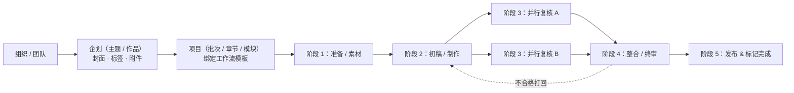
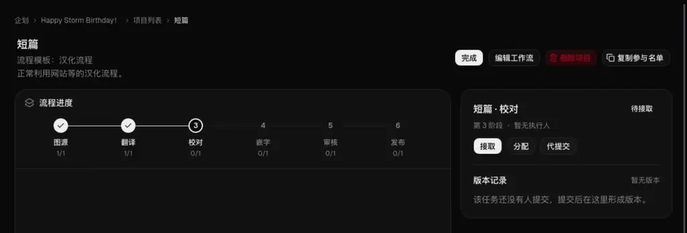
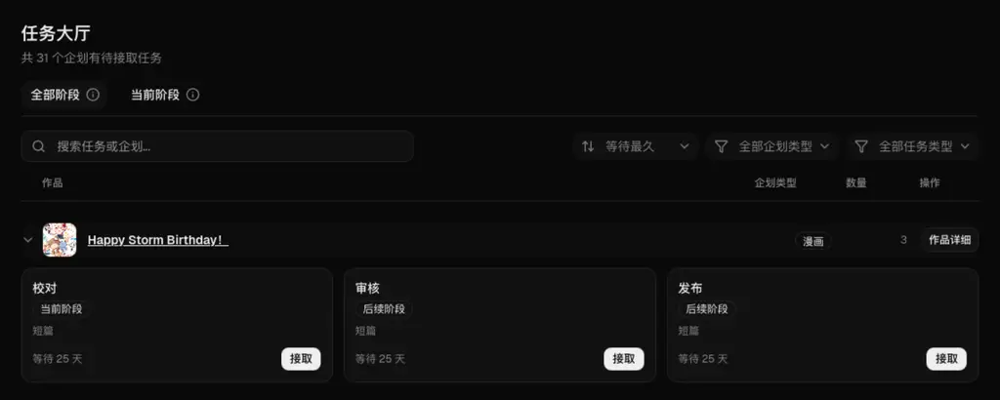
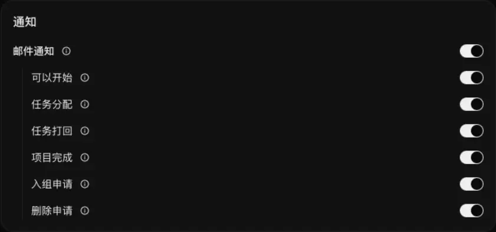
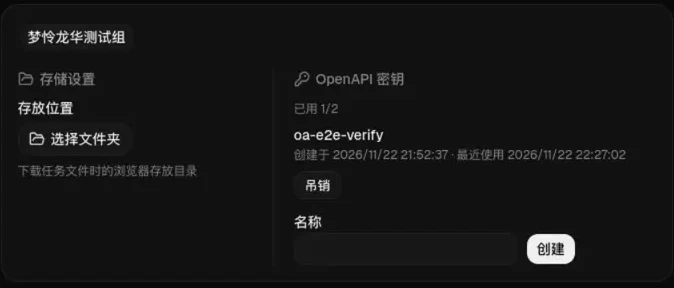
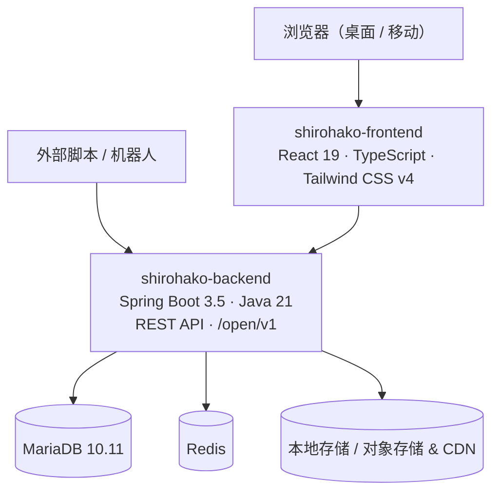

<p align="center">
  
</p>

<h1 align="center">白箱 ShiroHako</h1>

<p align="center">
  面向多阶段流程协作团队与组织的开源在线协作平台
</p>

<p align="center">
  <a href="./LICENSE"></a>
  
  
  
  
</p>

<p align="center">
  <a href="#核心概念与工作流">核心概念</a> ·
  <a href="#适用场景">适用场景</a> ·
  <a href="#功能特性">功能特性</a> ·
  <a href="#界面预览">界面预览</a> ·
  <a href="#技术架构">技术架构</a> ·
  <a href="#仓库结构">仓库结构</a> ·
  <a href="#参与贡献">参与贡献</a>
</p>

---

**白箱（ShiroHako）** 是一个面向各类组织与协作团队的开源在线协作平台，适用于任何按「**企划 → 项目 → 多阶段任务**」推进分工的团队（如内容创作、音视频制作、汉化/字幕与本地化、开源文档、社团活动策划、设计出版等）。从**企划立项、项目拆分，到任务认领、成果提交、审校打回与发布归档**，全流程在线完成，不再依赖电子表格、群聊接龙和口头催活。

## 为什么做白箱

跨成员、多环节协作中最常见的问题是流程不透明：任务散落在群消息里，进度靠追问，交接靠记忆，换人接手时更是无从查起。

白箱用一套轻量但结构清晰的可定制工作流把这些搬到线上——每个主题或作品是一个**企划**，企划内按批次、章节、模块或子目标拆分为**项目**，项目绑定自定义**工作流模板**后自动生成任务流。成员只需在任务大厅认领任务、查看待办并提交成果；负责人和管理员随时掌握整体进度、审校打回并一键汇总参与名单。

## 核心概念与工作流

白箱以「**组织 → 企划 → 项目 → 工作流任务**」组织协作，流程按阶段从前向后推进，同一阶段内支持多个并行步骤（以下为常见的内容制作流程示例，所有步骤与字段均可按组织实际业务自由定义）：



- **原子任务**：定义一种具体工序（如撰稿、翻译、剪辑、校对、设计、审核等）以及提交时需要填写的表单字段（文本、数字、选项、文件等）。
- **工作流模板**：通过可视化画布把原子任务编排为阶段与并行组，供项目复用；修改模板不会影响已经创建的项目流程。
- **项目任务流**：支持后续阶段提前接取，待前置阶段全部完成后解锁提交；全流程保留版本记录，支持按阶段状态打回重做。

## 适用场景

只要你的组织存在**多角色接力、分工认领、成果交付与审核流转**，都可以直接按自己的流程建模使用，例如：

- 内容创作与出版（漫画/小说汉化、字幕制作、专栏编辑、电子书与资料整理）
- 多媒体制作（视频剪辑、播客制作、配音、美术与设计交付）
- 社区与开源协作（文档本地化、活动筹备、社团项目分工、志愿团队任务流转）

## 功能特性

- **企划与项目管理**
  - 以主题或作品为单位管理企划，支持封面/缩略图裁剪、自定义元信息标签与预制标签、多维关键词检索。
  - 企划内按批次/章节/模块创建项目，支持附件管理、在线文件预览（文档、Office、压缩包等）与批量下载。
  - 项目进度一目了然，支持一键复制参与名单、完成确认以及高风险删除操作审核。
- **可视化工作流引擎**
  - 组织管理员可自定义原子任务提交字段，在拖拽式画布上编排串行阶段与并行组。
  - 个人模板与组织模板独立维护，灵活适配不同业务形态，不绑定固定行业或固定工序。
- **任务大厅与个人协作**
  - 成员在任务大厅按阶段、企划类型、任务类型和等待时长筛选待接取任务，支持接取、放弃、提交与查看历史版本。
  - 负责人与管理员可进行任务分配、代提交与审校打回；支持按事件细粒度配置邮件通知。
- **多组织与权限体系**
  - 原生支持多组织切换，提供邀请码（可设次数与有效期）与入组审批机制。
  - 区分组织所有者、组织管理员与普通成员权限，并配套独立的系统管理端。
- **开放接口与扩展能力**
  - 提供 `/open/v1` **OpenAPI**，支持个人 API Key 认证、游标分页与增量同步，便于接入聊天机器人（如 QQ / Discord / 飞书等）或自动化工作流工具。
- **现代使用体验**
  - 完整支持浅色/深色模式切换与独立主题色，响应式适配桌面端与移动端，内置基于 Fumadocs 的使用手册。

## 界面预览

<table>
  <tr>
    <td width="50%">
      
      <br />
      <sub><b>项目阶段进度与任务面板</b>：展示流程阶段、版本记录，以及接取、分配、代提交与复制参与名单</sub>
    </td>
    <td width="50%">
      
      <br />
      <sub><b>任务大厅</b>：按阶段、企划类型与任务类型筛选待接取任务，一眼看到等待时长</sub>
    </td>
  </tr>
  <tr>
    <td width="50%">
      
      <br />
      <sub><b>细粒度邮件通知</b>：按任务解锁、分配、打回、项目完成、入组/删除申请分别控制提醒</sub>
    </td>
    <td width="50%">
      
      <br />
      <sub><b>本地目录与 OpenAPI 密钥</b>：按组织记住浏览器下载目录，支持创建与吊销开放接口密钥</sub>
    </td>
  </tr>
</table>

## 技术架构



| 端 | 类别 | 核心技术 |
| --- | --- | --- |
| **前端** | 框架与语言 | React 19、TypeScript 5.9、React Router 7、TanStack Query |
| | 样式与组件 | Tailwind CSS v4、shadcn/ui、Base UI、XYFlow、File Viewer |
| | 构建与文档 | Vite Plus（`vp`）、pnpm、Fumadocs |
| **后端** | 框架与语言 | Java 21、Spring Boot 3.5、Spring Security + JWT |
| | 数据与缓存 | MariaDB 10.11、MyBatis-Plus 3.5、Redis / Redisson、Atlas 迁移 |
| | 接口文档 | Springdoc OpenAPI |
| **运维** | 容器与编排 | Docker Compose、Kubernetes（Kustomize） |

## 仓库结构

本仓库是一个聚合仓库（meta-repo），通过 Git submodule 关联前后端两个独立仓库，用于项目整体介绍、版本联动与统一问题反馈：

| 目录 | 说明 | 子仓库 |
| --- | --- | --- |
| `shirohako-frontend` | 白箱 Web 前端与内置使用手册 | [longlian-online/longlian-oa-frontend](https://github.com/longlian-online/longlian-oa-frontend)（跟踪 `main`） |
| `shirohako-backend` | 白箱服务端 API、数据库迁移与部署配置 | [longlian-online/longlian-oa-backend](https://github.com/longlian-online/longlian-oa-backend)（跟踪 `main`） |

> **关于命名**：项目品牌名为 **白箱 ShiroHako**，前后端子仓库因历史原因沿用组织项目名 `longlian-oa-*`，两者为同一项目的组成部分。

### 克隆与同步子模块

首次克隆（自动拉取前后端子模块）：

```bash
git clone --recurse-submodules https://github.com/longlian-online/ShiroHako.git
```

如果已经克隆了主仓库但子模块目录为空：

```bash
git submodule update --init --recursive
```

将本地子模块同步到各自 `main` 分支最新提交：

```bash
git submodule update --remote
```

> 前后端的本地运行、构建与部署方式，请分别参考 [前端仓库](https://github.com/longlian-online/longlian-oa-frontend) 与 [后端仓库](https://github.com/longlian-online/longlian-oa-backend) 各自的文档说明。

## 参与贡献

欢迎任何形式的贡献，包括但不限于反馈问题、提出协作场景建议、改进文档或提交代码 PR：

- 贡献流程与仓库分工请阅读 [CONTRIBUTING.md](./CONTRIBUTING.md)
- 安全漏洞报告请遵循 [SECURITY.md](./SECURITY.md)

## 开源协议

本项目基于 [Apache License 2.0](./LICENSE) 开源。

Copyright 2025-2026 longlian-online
